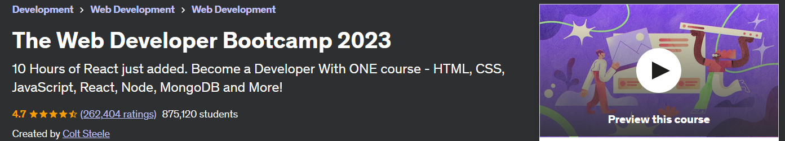
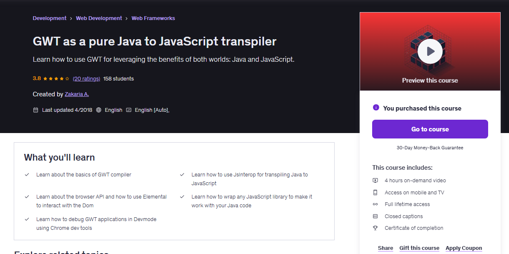
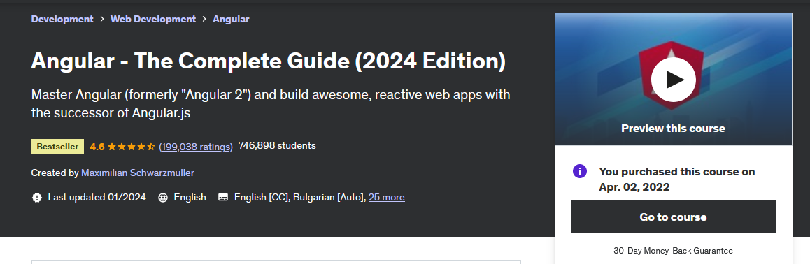
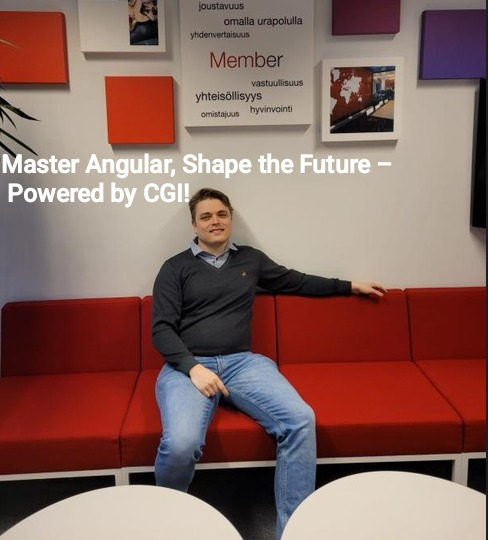
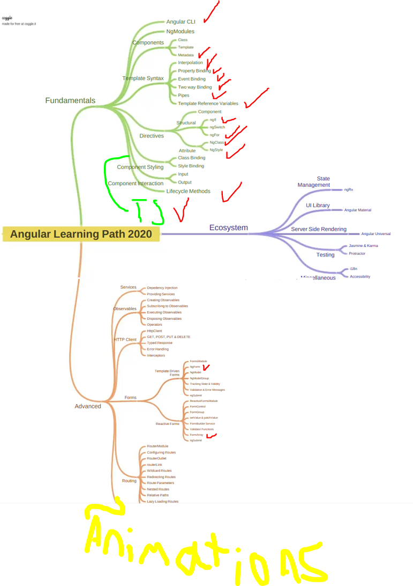

## The Web Developer Bootcamp.

<!-- 

We are using following structure:

<p 
align="center">
    
</p> 
<p 
align="center">
    
</p>
-->

<!--
Template for the questions:

# Quiz 07: Atomic Operations, Volatile & Metrics Practical Example.

<details>
<summary 
id="Quiz_01_Question_01"
open="true"> <b>Question 01.</b> </summary>
````Yaml
Question 01:
The question comes here!

- My answer:

<div
align="center">
    
</div>

1. Add here the answer!

</details>
-->

<!-- 
Template for the task/exercies:
 
# Lab Exercise - Mapping Collections of Value Types.

<div 
align="center">
    
</div>

1. **Question 1:** add here the question from the test!
	- **Answer:** **D**. here can be the examplaniton!
 -->

<p align="center">
    
</p>

Boosting my knowledge to up to speed. This contains exercise files and my own notes alongside with them.<br/>
Mini projects which are worth of showing are bolded in `The Major Projects`.

All course material from *The Web Developer Boot camp 2023* by **Colt Steele**
If the content sparked 🔥 your interest, please consider buying the course and start learning 📖

[The Course at Udemy](https://www.udemy.com/course/the-web-developer-bootcamp/)   


<p 
id="Logo_Combination" 
align="center">
    
    
</p>

**Note: The material provided in this repository is only for helping those who may get stuck at any point of time in the course. It is very advised that no one should just copy the solutions(violation of Honor Code) presented here.**

Official answers [here](https://github.com/Colt/TheWebDeveloperBootcampSolutions).

#### Progress/Curriculum.

- [x] Section 01 - Course Orientation.
- [X] [Section 02](https://github.com/developersCradle/web-dev-bootcamp/tree/master/Section%202) - An Introduction to Web Development.
- [X] [Section 03](https://github.com/developersCradle/web-dev-bootcamp/tree/master/Section%203) - HTML: The Essentials.
- [x] [Section 04](https://github.com/developersCradle/web-dev-bootcamp/tree/master/Section%204) - HTML: Next Steps & Semantics.
- [x] [Section 05](https://github.com/developersCradle/web-dev-bootcamp/tree/master/Section%205) - HTML: Forms & Tables.
- [x] [Section 06](https://github.com/developersCradle/web-dev-bootcamp/tree/master/Section%206) - CSS: The Very Basics.
- [x] [Section 07](https://github.com/developersCradle/web-dev-bootcamp/tree/master/Section%207) - The World of CSS Selectors.
- [x] [Section 08](https://github.com/developersCradle/web-dev-bootcamp/tree/master/Section%208) - The CSS Box Model.
- [x] [Section 09](https://github.com/developersCradle/web-dev-bootcamp/tree/master/Section%209) - Other Assorted Useful CSS Properties.
- [ ] [Section 10](https://github.com/developersCradle/web-dev-bootcamp/tree/master/Section%2010) - Responsive CSS & Flexbox.
- [ ] [Section 11](#) - Pricing Panel Project.
- [ ] [Section 12](#) - CSS Frameworks: Bootstrap.
- [ ] [Section 13](#) - OPTIONAL Museum Of Candy Project.
- [x] [Section 14](https://github.com/developersCradle/web-dev-bootcamp/tree/master/Section%2014) - JavaScript Basics!
- [x] [Section 15](https://github.com/developersCradle/web-dev-bootcamp/tree/master/Section%2015) - JavaScript Strings and More.
- [x] [Section 16](https://github.com/developersCradle/web-dev-bootcamp/tree/master/Section%2016) - JavaScript Decision Making.
- [x] [Section 17](https://github.com/developersCradle/web-dev-bootcamp/tree/master/Section%2017) - JavaScript Arrays.
- [x] [Section 18](https://github.com/developersCradle/web-dev-bootcamp/tree/master/Section%2018) - Section 18: JavaScript Object Literals.
- [x] [Section 19](https://github.com/developersCradle/web-dev-bootcamp/tree/master/Section%2019) - Section 19: Repeating Stuff With Loops.
- [x] [Section 20](https://github.com/developersCradle/web-dev-bootcamp/tree/master/Section%2020) - Introduction Function. Tee tehtävät kun aikaa!
- [x] [Section 21](https://github.com/developersCradle/web-dev-bootcamp/tree/master/Section%2021) - Leveling Up Our Function.
- [x] [Section 22](https://github.com/developersCradle/web-dev-bootcamp/tree/master/Section%2022) - Callbacks & Array Methods. 
- [x] [Section 23](https://github.com/developersCradle/web-dev-bootcamp/tree/master/Section%2023) - Newer JavaScript Features.
- [x] [Section 24](https://github.com/developersCradle/web-dev-bootcamp/tree/master/Section%2024) - Introducing The World Of The DOM. **selvitä pieni TODO**
- [x] [Section 25](https://github.com/developersCradle/web-dev-bootcamp/tree/master/Section%2025) - The Missing Piece: DOM Events.
- [ ] [Section 26](#) - Score Keeper CodeAlong
- [x] [Section 27](https://github.com/developersCradle/web-dev-bootcamp/tree/master/Section%2027) - Async JavaScript: Oh Boy!
- [x] [Section 28](https://github.com/developersCradle/web-dev-bootcamp/tree/master/Section%2028) - AJAX and API's.
- [x] [Section 29](https://github.com/developersCradle/web-dev-bootcamp/tree/master/Section%2029) - Prototypes, Classes, & OOP.
- [x] [Section 30](https://github.com/developersCradle/web-dev-bootcamp/tree/master/Section%2030) - Mastering The Terminal.
- [x] [Section 31](https://github.com/developersCradle/web-dev-bootcamp/tree/master/Section%2031) - Our First Brush With Node.
- [x] [Section 32](https://github.com/developersCradle/web-dev-bootcamp/tree/master/Section%2032) - Exploring Modules The NPM Universe.
- [x] [Section 33](https://github.com/developersCradle/web-dev-bootcamp/tree/master/Section%2033) - Creating Servers With Express.
- [ ] [Section 34](https://github.com/developersCradle/web-dev-bootcamp/tree/master/Section%2034) - Creating Dynamic HTML With Templating.
- [x] [Section 35](https://github.com/developersCradle/web-dev-bootcamp/tree/master/Section%2035) - Defining RESTful Routes. **TODO kts miten hostataan .ejs tiedostoja** ja **yksi todo**
- [ ] [Section 36](#) - Our First Database: MongoDB.
- [ ] [Section 37](#) - Connecting To Mongo With Mongoose.
- [ ] [Section 38](#) - Putting It All Together: Mongoose With Express.
- [ ] [Section 39](#) - YelpCamp: Campgrounds CRUD.
- [ ] [Section 40](#) - Middleware: The Key To Express.
- [ ] [Section 41](#) - YelpCamp: Adding Basic Styles.
- [ ] [Section 42](#) - Handling Errors In Express Apps.
- [ ] [Section 43](#) - YelpCamp: Errors & Validating Data.
- [ ] [Section 44](#) - Data Relationships With Mongo.
- [ ] [Section 45](#) - Mongo Relationships With Express.
- [ ] [Section 46](#) - YelpCamp: Adding The Reviews Model.
- [ ] [Section 47](#) - Express Router & Cookies.
- [ ] [Section 48](#) - Express Session & Flash.
- [ ] [Section 49](#) - YelpCamp: Restructuring & Flash.
- [ ] [Section 50](#) - Authentication From "Scratch".
- [ ] [Section 51](#) - YelpCamp: Adding In Authentication.
- [ ] [Section 52](#) - YelpCamp: Basic Authorization.
- [ ] [Section 53](#) - YelpCamp: Controllers & Star Ratings.
- [ ] [Section 54](#) - YelpCamp: Image Upload.
- [ ] [Section 55](#) - YelpCamp: Adding Maps.
- [ ] [Section 56](#) - YelpCamp: Fancy Cluster Map.
- [ ] [Section 57](#) - YelpCamp: Styles Clean Up.
- [ ] [Section 58](#) - YelpCamp: Common Security Issues.
- [ ] [Section 59](#) - YelpCamp: Deploying.
- [x] [Section 60](https://github.com/developersCradle/web-dev-bootcamp/tree/master/Section%2060) - Introducing React.
- [x] [Section 61](https://github.com/developersCradle/web-dev-bootcamp/tree/master/Section%2061) - JSX In Detail.
- [x] [Section 62](https://github.com/developersCradle/web-dev-bootcamp/tree/master/Section%2062) - Local React Apps With Vite.
- [x] [Section 63](https://github.com/developersCradle/web-dev-bootcamp/tree/master/Section%2063) - Working With Props.
- [x] [Section 64](https://github.com/developersCradle/web-dev-bootcamp/tree/master/Section%2064) - Shopping List Demo: keys, prop types, and more!
- [x] [Section 65](https://github.com/developersCradle/web-dev-bootcamp/tree/master/Section%2065) - React Events.
- [x] [Section 66](https://github.com/developersCradle/web-dev-bootcamp/tree/master/Section%2066) - The Basics of React State.
- [x] [Section 67](https://github.com/developersCradle/web-dev-bootcamp/tree/master/Section%2067) - Intermediate State Concept.
- [ ] [Section 68](https://github.com/developersCradle/web-dev-bootcamp/tree/master/Section%2068) - Component Design.
- [ ] [Section 69](#) - React Forms.
- [ ] [Section 70](#) - Effects.
- [ ] [Section 71](#) - Material UI.
- [ ] [Section 72](#) - Building a Todo List With Material UI & Local Storage.
- [ ] [Section 73](#) - BONUS: Fancy, More Advanced Todolist.

#### Additional stuff.

- [ ] Add some.

#### The Quizzes, Exercise and Labs.

* Section 03 Exercises.
    * [01_Exercise](https://htmlpreview.github.io/?https://github.com/developersCradle/web-dev-bootcamp/blob/master/Section%203/coding_exercise_pangoli_1.html)
    * [02_Exercise](https://htmlpreview.github.io/?https://github.com/developersCradle/web-dev-bootcamp/blob/master/Section%203/coding_exercise_favorite_exercise_2.html)
* Section 05 Exercises.
    * [Search Hack](https://htmlpreview.github.io/?https://github.com/developersCradle/web-dev-bootcamp/blob/master/Section%205/redditHack.html)
    * [Form Marathon](https://htmlpreview.github.io/?https://github.com/developersCradle/web-dev-bootcamp/blob/master/Section%205/marathonForm.html)
* Section 07 Exercises.
    * [09_Exercise](https://htmlpreview.github.io/?https://github.com/developersCradle/web-dev-bootcamp/blob/master/Section%207/coding_exercise_9.html)
    * [10_Exercise](https://htmlpreview.github.io/?https://github.com/developersCradle/web-dev-bootcamp/blob/master/Section%207/coding_exercise_10.html)
    * [11_Exercise](https://htmlpreview.github.io/?https://github.com/developersCradle/web-dev-bootcamp/blob/master/Section%207/Coding_Exercise_11.html)
* Section 08 Exercises.
    * [12_Exercise](#)
    * [Box Model](#)
* Section 09 Exercises.
    * [Translations and Transforms](https://htmlpreview.github.io/?https://github.com/developersCradle/web-dev-bootcamp/blob/master/Section%209/Translations%20and%20Transforms/index.html)
    * [Hover Button](https://htmlpreview.github.io/?https://github.com/developersCradle/web-dev-bootcamp/blob/master/Section%209/Hover/index.html)
    * [Photo Blog ~ Korea Gallery](https://htmlpreview.github.io/?https://github.com/developersCradle/web-dev-bootcamp/blob/master/Section%209/Korea%20Gallery/photoGrid.html)
    * [Blog](https://htmlpreview.github.io/?https://github.com/developersCradle/web-dev-bootcamp/blob/master/Section%209/Blog/blog.html)
    * [Fonts](http://htmlpreview.github.io/?https://github.com/developersCradle/web-dev-bootcamp/blob/master/Section%209/Fonts/fonts.html)    
* Section 24 Exercises.
    * [Pokemon Demo](https://htmlpreview.github.io/?https://github.com/developersCradle/web-dev-bootcamp/blob/master/Section%2024/pokemon.html)
* Section 25 Exercises.
    * [59_Exercise](https://htmlpreview.github.io/?https://github.com/developersCradle/web-dev-bootcamp/blob/master/Section%2025/coding_exercise_59.html)
    * [60_Exercise](https://htmlpreview.github.io/?https://github.com/developersCradle/web-dev-bootcamp/blob/master/Section%2025/coding_exercise_60.html) 
    * [Random Color](https://htmlpreview.github.io/?https://github.com/developersCradle/web-dev-bootcamp/blob/master/Section%2025/randomColor.html) **← Random Color game**
* Section 28 Exercises.
    * [TV Search App](https://htmlpreview.github.io/?https://github.com/developersCradle/web-dev-bootcamp/blob/master/Section%2028/tvSearch.html)  **← TV Show Search App**
* Section 32 Exercises.
    * [Language Dedection App](#) **TODO selvitä heikki miten node appi saadaan juostua tai demonstroitua**
* Section 61 Exercises.
    * [Random Pokemon Card](https://codesandbox.io/s/thirsty-allen-9yzhc4?file=/src/RandomPokemon.js)  **← Random Pokémon card**
* Section 63 Exercises.
    * [Game Slot Game](https://codesandbox.io/s/trusting-star-5fk4ls?file=/src/App.js)  **← Potato fruit game**
* Section 64 Exercises.
    * [List Exercise](https://codesandbox.io/s/compassionate-currying-vrr3m7?file=/src/App.js)
* Section 65 Exercises
    * [Clicker Exercise](https://codesandbox.io/s/hardcore-mahavira-y6kklm?file=/src/App.js)
* Section 66 Exercises.
    * [Click Color Boxes Game](https://codesandbox.io/s/adoring-chaum-6sgl22?file=/src/App.js)
* Section 67 Exercises.
    * [Score Keeper](https://codesandbox.io/s/musing-snow-393l38?file=/src/App.js)

- Todo kts tehtävät ja lisäää    
- Todo muuta tehtävien nimetydehnmukaiseksi ja katso nuoli ja boldaus
- Todo joku css liittyvä projekti ja linkkaa tänne, niin saa ajattua opit loppuun asti
- TODO katso tehtävät lävitse listtaan
- TODO typot ja formatointi. Katso tätä systemaattisesti eteenpäin: 1,2,3,4,5
- TODO selvitä ja siivoa node_modules pois

FROM OLD COURSE FROM HERE ONE, RawGit got deprecated, some links migrated to HTML preview and work

## The Major Projects.
* Section 03 Exercises
    * [01_Exercise](https://rawgit.com/developersCradle/MyProjects/master/WebDevBootcamp/Web%20Developer%20Bootcamp/03%20Introduction%20to%20HTML/1_Exercise.html)
    * [02_Exercise](https://rawgit.com/developersCradle/MyProjects/master/WebDevBootcamp/Web%20Developer%20Bootcamp/03%20Introduction%20to%20HTML/2_Exercise.html)
    
* Section 04 Exercises.
    * [01_Exercise](https://cdn.rawgit.com/developersCradle/MyProjects/6f1162c0/WebDevBootcamp/Web%20Developer%20Bootcamp/04%20Intermediate%20HTML/Exercise_1.html)
    * [02_Exercise](https://cdn.rawgit.com/developersCradle/MyProjects/6f1162c0/WebDevBootcamp/Web%20Developer%20Bootcamp/04%20Intermediate%20HTML/Exercise_2.html)

* Section 05 Exercises.
    * [01_Exercise](https://cdn.rawgit.com/developersCradle/MyProjects/c03b65ca/WebDevBootcamp/Web%20Developer%20Bootcamp/05%20Introduction%20to%20CSS/selectorsExercise.html)

* Section 06 Exercises.
    * [01_Exercise](https://cdn.rawgit.com/developersCradle/MyProjects/a7c4e76a/WebDevBootcamp/Web%20Developer%20Bootcamp/06%20Intermediate%20CSS/board.html)
    * [03_Exercise](https://htmlpreview.github.io/?https://github.com/developersCradle/web-dev-bootcamp/blob/master/Archive/06%20Intermediate%20CSS/blog.html) **<-- Simple blog**

* Section 07 Exercises.
	* [01_Exercise](https://htmlpreview.github.io/?https://github.com/developersCradle/web-dev-bootcamp/blob/master/Archive/07%20Bootstrap/gallery.html) **<-- Image gallery using Bootstrap**
	* [02_Exercise](https://htmlpreview.github.io/?https://github.com/developersCradle/web-dev-bootcamp/blob/master/Archive/07%20Bootstrap/index.html) **<-- Startup page with Bootstrap**

* Section 08 Exercises.
    * [01_Exercise](https://rawgit.com/developersCradle/MyProjects/master/WebDevBootcamp/Web%20Developer%20Bootcamp/08%20Introduction%20to%20JavaScript/stalker.html)
    * [02_Exercise](https://rawgit.com/developersCradle/MyProjects/master/WebDevBootcamp/Web%20Developer%20Bootcamp/08%20Introduction%20to%20JavaScript/calc.html)

## Files.

* [Slides](https://webdev.slides.com/coltsteele/)

IS needed?

MYSTERY TO BE SOLVED
https://github.com/developersCradle/web-dev-bootcamp/commit/5e1f81b3bc7fde34061b5d66347bba4ac64333f7
```Js
const person = {
    firstName: 'Viggo',
    lastName: 'Mortensen',
    fullName: function () {
        return `${this.firstName} ${this.lastName}`
    },
    shoutName: function () {
        setTimeout(() => {
            //keyword 'this' in arrow functions refers to the value of 'this' when the function is created
            console.log(this);
            console.log(this.fullName())
        }, 3000)
    }
} 
```

## GWT as a pure Java to JavaScript transpiler.

<!-- 
<p 
align="center">
    
</p> -->

<p 
align="center">
    
</p> 

All course material from *GWT as a pure Java to JavaScript transpiler* by **Zakaria A.**

> When I was working at 👓👁️**𝐓𝐨𝐩𝐜𝐨𝐧 𝐇𝐞𝐚𝐥𝐭𝐡𝐜𝐚𝐫𝐞 𝐒𝐲𝐬𝐭𝐞𝐦𝐬**👁️👓, I was involved in integrating advanced AI capabilities into ophthalmic imaging workflows. One of the key challenges we faced was incorporating the EyeArt AI solution into our pipeline for processing fundus images, ensuring that results were not only accurate but also seamlessly available within our speedy systems. 🐟 
>
> By leveraging the latest **𝐭𝐨𝐩-𝐧𝐨𝐭𝐜𝐡** **𝐆**oogle **𝐖**eb **𝐓**oolkit’s **𝐉𝐒𝐈𝐧𝐭𝐞𝐫𝐨𝐩** capabilities, it became surprisingly smooth to bridge Java and JavaScript worlds, making development efficient and maintainable. 🐟
>
> While working on this integration, the course *“𝘎𝘞𝘛 𝘢𝘴 𝘢 𝘗𝘶𝘳𝘦 𝘑𝘢𝘷𝘢 𝘵𝘰 𝘑𝘢𝘷𝘢𝘚𝘤𝘳𝘪𝘱𝘵 𝘛𝘳𝘢𝘯𝘴𝘱𝘪𝘭𝘦𝘳”* came in especially handy, helping me better understand how to structure interoperable code and fully utilize JSInterop in real-world scenarios. 🐟 <br><br>~ DevelopersCradle

Contains my own with my own visual notes ✍️ with some course material to enforce learning experience.

<!-- todo eclipse here if possible -->

<!-- 
This repository is made with [](#) with [](#) hotkeys, therefore it will include configuration files which are related to this IDE this approach will be favored for now. ⚙️ -->

We are using [](#). Instead, the which are recommended!
<!-- Todo this link -->
[Udemy course](https://www.udemy.com/course/gwt-as-a-pure-java-to-javascript-transpiler/).

[Homepage of maker](https://www.zakariaamine.com/).

If the content sparked :fire: your interest, please consider buying the course and start learning :book:.

<!-- 
Linkedin puts this shit front, when clicking from private mode x(. Need to put this to make jump working every case
?trk=public_profile_see-credential 
-->

<p 
id="Logo_Combination" 
align="center">
    
    
</p>

**Note: The material provided in this repository is only for helping those who may get stuck at any point of time in the course. It is very advised that no one should just copy the solutions(violation of Honor Code) presented here.**

#### Progress/Curriculum.

- [x] [Section 01](#).

#### Additional stuff.

- Add here

#### The Quizzes and Labs.

* **Section 0x**:
    * *Quiz*:
        * [Quiz 00: xx](#) 

# Angular - The Complete Guide (2022 Edition).



All course material from **Angular - The Complete Guide (2024 Edition)** by Maximilian Schwarzmüller

> 🐟 <br><br>~ DevelopersCradle

My OS will be Windows 10, so some notes are based on this operating system. This contains exercise files and my own notes alongside with them.


If the content sparked :fire: your interest, please consider buying the course and start learning :book:

[The Course at Udemy](https://www.udemy.com/course/the-complete-guide-to-angular-2/).   
[Acade Mind](https://academind.com/).   
 
**Note: The material provided in this repository is only for helping those who may get stuck at any point of time in the course. It is very advised that no one should just copy the solutions(violation of Honor Code) presented here.**

<!-- 
Linkedin puts this shit front, when clicking from private mode x(. Need to put this to make jump working every case
?trk=public_profile_see-credential 
-->
<!-- 
Linkedin puts this shit front, when clicking from private mode x(. Need to put this to make jump working every case
?trk=public_profile_see-credential 
-->

<p 
id="Logo_Combination" 
align="center">
    
    
</p>
<details>

<summary id="Angular Learning Path" open="true"> <b> Angular Learning Path 2020! </b> </summary>

<br>

<p align="center">
    
</p>

</details>


#### Progress/Curriculum.

- [x] [Section 01](https://github.com/developersCradle/angular-complete-guide/tree/main/Section%201%20Gettings%20Started) - Getting Started
- [x] [Section 02](https://github.com/developersCradle/angular-complete-guide/tree/main/Section%202%20The%20Basics) - The Basics 
- [x] [Section 03](https://github.com/developersCradle/angular-complete-guide/tree/main/Section%203%20Course%20Project%20-%20The%20Basics) - Course Project - The Basics
- [x] [Section 04](https://github.com/developersCradle/angular-complete-guide/tree/main/Section%204%20Debugging) - Debugging
- [ ] [Section 05](https://github.com/developersCradle/angular-complete-guide/tree/main/Section%205%20Components%20%26%20Databinding%20Deep%20Dive) - Components & Data binding Deep Dive
- [ ] [Section 06](#) - Course Project - Components & Data binding
- [ ] [Section 07](#) - Directives Deep Dive
- [ ] [Section 08](#) - Course Project - Directives
- [ ] [Section 09](#) - Using Services & Dependency Injection
- [ ] [Section 10](#) - Course Project - Services & Dependency Injection
- [ ] [Section 11](#) - Changing Pages with Routing
- [ ] [Section 12](#) - Course Project - Routing 
- [x] [Section 13](https://github.com/developersCradle/angular-complete-guide/tree/main/Section%2013%20%20Understanding%20Observables) - Understanding Observables
- [ ] [Section 14](#) - Course Project - Observables
- [ ] [Section 15](https://github.com/developersCradle/angular-complete-guide/tree/main/Section%2015%20Handling%20Forms%20in%20Angular%20Apps) - Handling Forms in Angular Apps
- [ ] [Section 16](#) - Course Project - Forms
- [x] [Section 17](https://github.com/developersCradle/angular-complete-guide/tree/main/Section%2017%20Using%20Pipes%20to%20Transform%20Output) - Using Pipes to Transform Output 
- [ ] [Section 18](#) - Making Http Requests 
- [ ] [Section 19](#) - Course Project - Http
- [ ] [Section 20](#) - Authentication & Route Protection in Angular
- [ ] [Section 21](#) - Dynamic Components
- [ ] [Section 22](#) - Angular Modules & Optimizing Angular Apps
- [ ] [Section 23](#) - Deploying an Angular App 
- [ ] [Section 24](#) - Standalone Components
- [ ] [Section 25](#) - Angular Signals
- [ ] [Section 26](#) - Bonus: Using NgRx For State Management
- [ ] [Section 27](#) - Bonus: Angular Universal
- [ ] [Section 28](#) - Angular Animations
- [ ] [Section 29](#) - Adding Offline Capabilities with Service Workers
- [ ] [Section 30](#) - A Basic Introduction to Unit Testing in Angular Apps
- [ ] [Section 31](#) - Angular as a Platform & Closer Look at the CLI
- [ ] [Section 32](#) - Angular Changes & New Features
- [ ] [Section 33](#) - Course Roundup
- [x] [Section 34](https://github.com/developersCradle/angular-complete-guide/tree/main/Section%2033%20TypeScript%20Introduction%20(for%20Angular%202%20Usage)) - TypeScript Introduction (for Angular 2 Usage)

#### The Quizzes and Labs.

* **Section 01**:
    * *Quiz*:
        * [Some here](#).
    * *Coding Exercise*:
        * [Coding Exercise 01 here](#).

#### Additional stuff.

- todo fix the forms chapter viewChild thing
- [ ] Lastly thought Angular documents as refreshment 
- [ ] some minor angular project, magic/religious calendar app just for fun